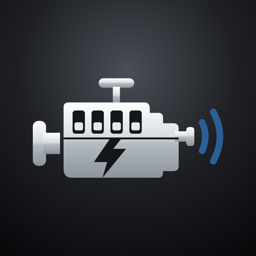

# EVroom

Connect to a Tesla vehicle to create a virtual engine sound using real speed and output. You can also enjoy it by inputting sounds tailored to your personal preferences.

Free · Requires iOS 18.6 or later · Lifestyle

[**View on the App Store**](https://apps.apple.com/kr/app/evroom/id6826833974)

## Sounds

Sound files you can use in EVroom. Download a file and import it into the app.

<!--
Maintainers: after merging a sound PR, add one row per file (and delete the "No sounds yet" row):
| `file-name.wav` | Short description | <a href="sound/file-name.wav" download>Download</a> |
-->

| File | Description | Download |
|---|---|---|
| `evroom-idle-15s.wav` | A steady idle sound of a typical inline-four engine, looped seamlessly for 15 seconds | <a href="sound/evroom-idle-15s.wav" download>Download</a> |

## Contribute a sound

Anyone can add a sound to this list through a pull request.

1. Prepare your sound file. Use a short name with lowercase letters, numbers and hyphens, for example `v8-rumble.wav`.
2. Open the [`docs/sound`](https://github.com/HJ-Lee-coder/EVroom/tree/main/docs/sound) folder on GitHub, choose **Add file > Upload files**, and drop your file in. You need a free GitHub account. GitHub forks the repository for you automatically.
3. Click **Propose changes**, then **Create pull request**. In the description, write one short sentence describing your sound.
4. Once the pull request is reviewed and merged, your sound appears in the list above.

Guidelines:

- A good recording has little pitch variation and a steady rotation speed (RPM), and lasts a few tens of seconds.
- WAV or MP3 files are recommended.
- Keep files small, a few MB at most.
- Only submit sounds you created or have permission to share publicly.

## Support

- Contact: tinyfunapp@gmail.com
- [Privacy Policy (English)](privacy-en.md)
- [Privacy Policy (Korean)](privacy-ko.md)
